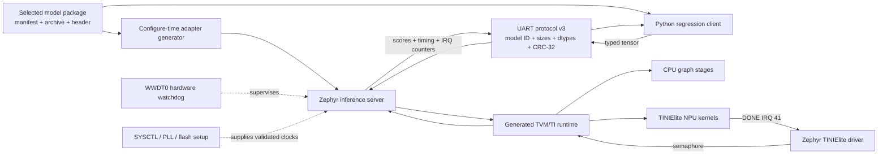
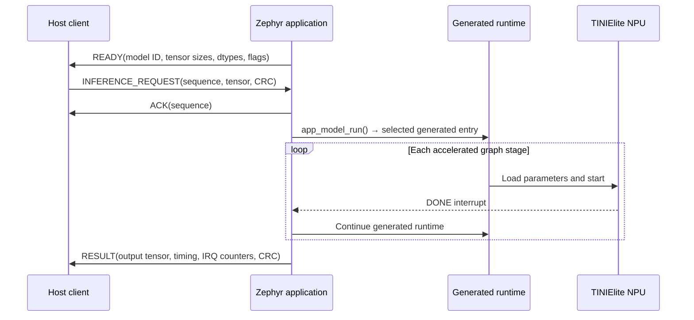

# AM13E230 TINIElite Edge AI on Zephyr

[](https://github.com/jainilbavishi24/am13e230-tinielite-zephyr/actions/workflows/ci.yml)
[](LICENSE)

This project is a reusable, on-device Edge AI inference platform for Texas
Instruments' preview LP-AM13E230 LaunchPad. A Python client sends a typed time-
series tensor over USB UART; Zephyr firmware runs the selected TVM-generated
network, offloads supported graph stages to the AM13E230 TINIElite NPU, and
returns the complete output tensor with timing and interrupt diagnostics. The
inference runs locally on the microcontroller—no cloud service is involved.

Two real TI-generated model packages are included:

| Package | Input | Output | Current evidence |
|---|---|---|---|
| `waveform_classifier` (default) | 256 samples, normalized and quantized to int8 | Sawtooth / sine / square scores | Protocol-v3 physical acceptance passed: 600/600 exact, 5 NPU IRQs/run |
| `electrical_fault_6class` | 6 channels × 128 samples as raw float32 | No fault, BC, ABC, AG, ABG, or ABCG scores | Protocol-v3 physical acceptance passed: 600/600 exact, 8 NPU IRQs/run |

Because the preview AM13E230 platform is not supported by the pinned upstream
Zephyr release, this repository also supplies the board, SoC, devicetree,
pinctrl, UART, clock, watchdog, and NPU integration needed to run the
application. These components are kept outside the upstream Zephyr source tree
(an *out-of-tree port*) so the project can be built reproducibly without
patching Zephyr itself.

The firmware is **build-time model-package selectable**. Tensor sizes, data
types, labels, generated symbol names, preprocessing metadata, and archive
identity and generated-runtime ABI names come from `models/<name>/model.json`.
CMake generates the small C adapter during configuration. The two packages
exercise different input shapes and preprocessing paths without hand-written
per-model C or changes to the UART/NPU path. This is compile-time selection,
not runtime loading of arbitrary `.a` files.

## Highlights

- Out-of-tree Zephyr board, SoC, devicetree, pinctrl, UART, and TINIElite
  support—without patching the upstream Zephyr tree.
- TI-aligned 200 MHz clock startup with three flash wait states and live
  register read-back validation.
- Interrupt-driven NPU completion on IRQ 41 with bounded waits, acknowledged
  completion counters, and spurious-interrupt detection.
- Versioned UART protocol with sequence numbers, explicit lengths, CRC-32,
  model identity/capabilities, structured errors, resynchronization, and
  bounded host retries.
- Validated model-package contract with build-time selection and an
  automatically generated adapter boundary around TI names and structures.
- Recovery from malformed frames, NPU stalls, and whole-firmware deadlocks.
- Independent four-second WWDT0 hardware watchdog with reset-cause validation.
- Reproducible host tests, sanitized Zephyr-native tests, static analysis,
  cross-compilation, ELF symbol checks, and downloadable CI artifacts.

## Validation status

The model-package/protocol-v3 revision passes 28 host tests, five ASan/UBSan
Zephyr-native protocol tests, static analysis, pristine Arm cross-builds, and
physical acceptance of both real model archives on LP-AM13E230. The complete
2026-11-10 runs exercised exact fixtures, CRC recovery, NPU timeout/cold-reset
recovery, independent WWDT0 recovery, clock read-back, and repeated inference.

| Measurement | `waveform_classifier` | `electrical_fault_6class` |
|---|---:|---:|
| Exact repeated fixtures | 600/600 | 600/600 |
| Transport retries | 0 | 0 |
| NPU completion | 5 IRQs/inference | 8 IRQs/inference |
| Spurious NPU interrupts | 0 | 0 |
| Accelerator time | 553 µs median | 330 µs median |
| Runtime/CPU portion | 118 µs median | 525 µs median |
| End-to-end inference | 689 µs median | 881 µs median |
| Active clocks | 200 MHz MCLK; 100 MHz UART | 200 MHz MCLK; 100 MHz UART |
| Firmware footprint | 25,656 B flash; 43,616 B RAM | 31,752 B flash; 41,320 B RAM |

The exact-score counts are regression evidence against supplied generated
fixtures, not independent model-accuracy measurements. Electrical-model
quality is reported separately below and in its evaluation document.

These numbers are board measurements, not simulated estimates. Full commands,
raw register values, historical corrections, and JSON evidence are in
[docs/VALIDATION.md](docs/VALIDATION.md).

## System architecture





The server intentionally processes one request at a time. This keeps the
opaque generated-runtime state, timing, error recovery, and watchdog feeding
deterministic. See [docs/ARCHITECTURE.md](docs/ARCHITECTURE.md) and
[docs/PROTOCOL.md](docs/PROTOCOL.md) for implementation details.

## Repository structure

| Path | Purpose |
|---|---|
| `app/` | Inference server, clock telemetry, protocol, and watchdog control |
| `boards/` | LP-AM13E230 out-of-tree board definition |
| `soc/` | AM13E230 SoC startup and pinctrl interface |
| `dts/` | SoC description and custom devicetree bindings |
| `drivers/` | UNICOMM UART, pinctrl, and TINIElite drivers |
| `models/` | Build-time packages: manifest, artifacts, licenses, and fixtures |
| `tools/` | Python protocol and hardware-regression client |
| `scripts/` | Build, flash, test, static-check, and WSL USB helpers |
| `tests/` | Host unit tests and Zephyr `native_sim` ztests |
| `docs/` | Indexed engineering documentation and versioned hardware evidence |
| `explanation/` | Interview-study PDFs, their HTML sources, and PDF generator |
| `config/debug/` | TI XDS110/DSLite target configuration |
| `config/udev/` | Restricted Linux USB permission rules |
| `zephyr/` | Zephyr module-discovery metadata; not an upstream checkout |

Start with the [documentation index](docs/README.md) for topic-oriented
navigation. Zephyr requires the platform roots and top-level build metadata to
remain in their current locations; [the index explains why](docs/README.md#why-some-directories-must-remain-at-the-root).

## Prerequisites

The validated environment is Ubuntu 22.04 under WSL 2 with GNU Arm Embedded
GCC 10.3.1 and TI UniFlash 9.7. Install the Linux build dependencies with:

```bash
sudo apt-get update
sudo apt-get install --no-install-recommends -y \
  clang-format cmake cppcheck device-tree-compiler gcc-arm-none-eabi \
  gcc-multilib gperf ninja-build python3-venv shellcheck
```

TI UniFlash is required only for physical-board programming. The scripts use
`~/ti/uniflash_9.7.0` by default; set `TI_UNIFLASH_ROOT` when it is installed
elsewhere.

## Create a clean west workspace

The manifest pins Zephyr and the required CMSIS modules. Start from a directory
that does not contain an older in-tree `lp_am13e230` port:

```bash
mkdir am13e230-workspace
cd am13e230-workspace
git clone https://github.com/jainilbavishi24/am13e230-tinielite-zephyr.git

python3 -m venv .venv
. .venv/bin/activate
python -m pip install west

west init -l am13e230-tinielite-zephyr
west update
python -m pip install -r zephyr/scripts/requirements.txt
python -m pip install -r am13e230-tinielite-zephyr/requirements.txt
python -m pip install -r am13e230-tinielite-zephyr/requirements-dev.txt
```

The pinned upstream revisions are recorded in [west.yml](west.yml).

## Build

```bash
cd am13e230-tinielite-zephyr
./scripts/build.sh
```

The output image is `build/zephyr/zephyr.hex`. Set `WEST_BIN` if `west` is not
available on `PATH`.

Select a compatible package either way:

```bash
APP_MODEL=waveform_classifier ./scripts/build.sh
# Equivalent: ./scripts/build.sh -- -DAPP_MODEL=waveform_classifier

APP_MODEL=electrical_fault_6class PRISTINE=always ./scripts/build.sh
```

See [docs/MODEL_PACKAGES.md](docs/MODEL_PACKAGES.md) before adding a new model.

## Attach the XDS110 to WSL

Install `usbipd-win` on Windows, then use an elevated PowerShell. Find the
current XDS110 BUSID first because it may change after reconnecting:

```powershell
& "C:\Program Files\usbipd-win\usbipd.exe" list
& "C:\Program Files\usbipd-win\usbipd.exe" bind --force --busid 4-3
& "C:\Program Files\usbipd-win\usbipd.exe" attach --wsl --busid 4-3
```

Replace `4-3` with the BUSID shown for `0451:bef3`. Then configure restricted
device access in WSL:

```bash
./scripts/setup_xds110_wsl.sh
```

Restart the WSL shell after the first setup so `dialout` group membership is
active.

XDS110 exposes two serial interfaces. The application/User UART is `if00`
(normally `/dev/ttyACM0`); the client prefers that interface automatically and
clears buffered frames left by a previously flashed image.

## Flash and run

```bash
./scripts/flash.sh
./scripts/test.sh
```

Or build, flash, and run every fixture in the selected package in one command:

```bash
./scripts/pipeline.sh
```

Press the LaunchPad RESET button once after flashing if the client reports
that it did not receive `READY`.

The client selects the same package with `--model NAME`, or from `APP_MODEL`:

```bash
APP_MODEL=waveform_classifier ./scripts/test.sh
```

## Validation commands

For the default six-fixture waveform package, run CRC fault injection followed
by 600 inferences:

```bash
./scripts/test.sh --fault-test --repeat 100 --quiet \
  --json-output docs/evidence/protocol_v3/hardware_stress.json
```

Validate clock configuration and raw register state:

```bash
./scripts/test.sh --clock-status \
  --json-output docs/evidence/protocol_v3/hardware_clock.json
```

The client also supports `--npu-fault-test` and `--watchdog-fault-test` for
deliberate reset-recovery tests. These commands require firmware built with the
corresponding diagnostic Kconfig options; disable fault injection in deployed
configurations.

## Software quality checks

```bash
ruff check tools tests
ruff format --check tools tests
python -m unittest discover -s tests -v
./scripts/static_check.sh
shellcheck scripts/*.sh
```

CI additionally runs the protocol ztests on Zephyr `native_sim` with
AddressSanitizer and UndefinedBehaviorSanitizer, cross-builds the firmware in a
clean pinned workspace, verifies critical ELF symbols, validates model hashes,
and publishes the ELF, HEX, map, and symbol files.

## Project boundaries

This repository demonstrates embedded platform bring-up and on-device NPU
inference. It does not contain the original training pipeline, source model,
independent evaluation dataset, or model-generation toolchain; the available
model input is the licensed generated `mod.a`, its header, and six regression
fixtures. Consequently:

- The six waveform fixtures and 12 electrical-fault fixtures establish
  deterministic regression behavior, not general model accuracy.
- The electrical-fault export reports 87.4845% on its held-out file, but ABCG
  recall is only 9/99 and the small, overlapping-window dataset is not an
  independent real-world evaluation. It is an integration baseline, not a
  production protection system.
- A CPU-equivalent benchmark and full model regeneration require a documented,
  redistributable training pipeline and dataset, not only generated outputs.
- Model-package abstraction is cross-link and physical-board verified with two
  real TI exports using the same generated-adapter and protocol path.
- Whole-system power and exact CPU-utilization measurements require external
  instrumentation or trace hardware.
- UART data transfer currently uses Zephyr's polling API; pinctrl and receive
  error reporting are implemented, while interrupt/async transfer is future
  work.
- The port is maintained out of tree and has not been submitted upstream.

The live completion matrix is in
[docs/QUALITY_GATES.md](docs/QUALITY_GATES.md), and planned work is tracked in
[docs/ROADMAP.md](docs/ROADMAP.md).

## Documentation

- [Agent-ready project handoff](docs/PROJECT_HANDOFF.md)
- [Complete project explanation and interview study PDFs](explanation/README.md), starting with the [foundations guide](explanation/00_foundations_for_understanding.pdf)
- [Architecture](docs/ARCHITECTURE.md)
- [UART protocol](docs/PROTOCOL.md)
- [Model-package integration guide](docs/MODEL_PACKAGES.md)
- [Hardware validation](docs/VALIDATION.md)
- [Engineering quality gates](docs/QUALITY_GATES.md)
- [Critical audit](docs/AUDIT.md)
- [Roadmap](docs/ROADMAP.md)
- [Contributing](CONTRIBUTING.md)

## License

Project-authored source is licensed under Apache-2.0. Generated model artifacts
and fixtures retain their separate terms in
[models/waveform_classifier/LICENSE.txt](models/waveform_classifier/LICENSE.txt)
and
[models/electrical_fault_6class/LICENSE.txt](models/electrical_fault_6class/LICENSE.txt).
See [THIRD_PARTY_NOTICES.md](THIRD_PARTY_NOTICES.md) before redistribution.
