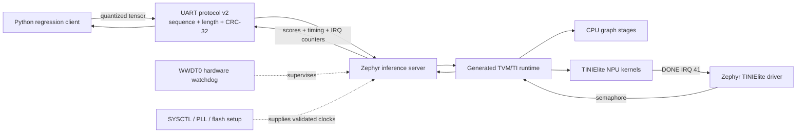
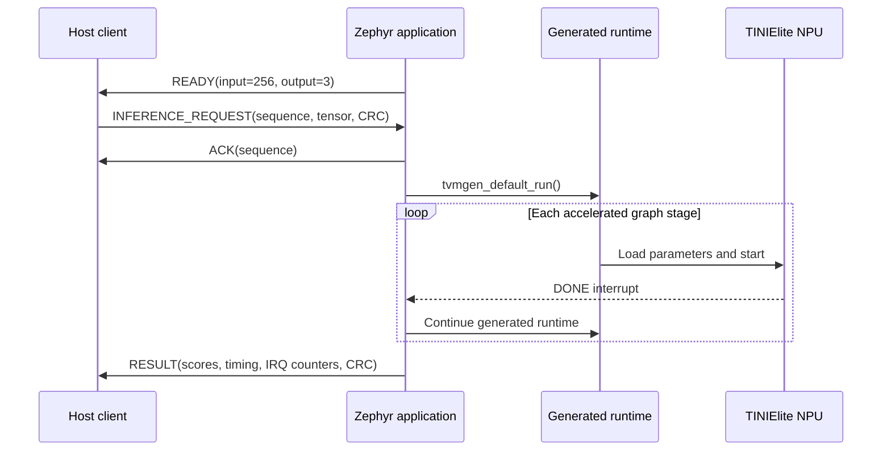

# AM13E230 TINIElite Edge AI on Zephyr

[](https://github.com/jainilbavishi24/am13e230-tinielite-zephyr/actions/workflows/ci.yml)
[](LICENSE)

This project turns a Texas Instruments LP-AM13E230 LaunchPad into a small
edge-AI waveform classifier. Given 256 samples from a waveform, it performs
inference on the physical microcontroller and scores the signal as one of
three classes: **sawtooth, sine, or square**.

A Python client reads the sample vector, applies the normalization and
8-bit quantization required by the model, and sends the resulting tensor to
the board over USB UART. Zephyr firmware runs the TVM-generated neural network,
offloads its supported convolution and pooling stages to the AM13E230
TINIElite NPU, and returns the three class scores together with timing and NPU
interrupt diagnostics. The inference itself runs locally on the board; no
cloud service is involved.

Because the preview AM13E230 platform is not supported by the pinned upstream
Zephyr release, this repository also supplies the board, SoC, devicetree,
pinctrl, UART, clock, watchdog, and NPU integration needed to run the
application. These components are kept outside the upstream Zephyr source tree
(an *out-of-tree port*) so the project can be built reproducibly without
patching Zephyr itself.

## Highlights

- Out-of-tree Zephyr board, SoC, devicetree, pinctrl, UART, and TINIElite
  support—without patching the upstream Zephyr tree.
- TI-aligned 200 MHz clock startup with three flash wait states and live
  register read-back validation.
- Interrupt-driven NPU completion on IRQ 41 with bounded waits, acknowledged
  completion counters, and spurious-interrupt detection.
- Versioned UART protocol with sequence numbers, explicit lengths, CRC-32,
  structured errors, resynchronization, and bounded host retries.
- Recovery from malformed frames, NPU stalls, and whole-firmware deadlocks.
- Independent four-second WWDT0 hardware watchdog with reset-cause validation.
- Reproducible host tests, sanitized Zephyr-native tests, static analysis,
  cross-compilation, ELF symbol checks, and downloadable CI artifacts.

## Verified hardware results

| Measurement | Result |
|---|---:|
| Golden fixtures | 6/6 exact score vectors |
| Stress regression | 600/600 inferences, zero retries |
| NPU completion | 5 IRQs per inference; 3,000 total |
| Spurious NPU interrupts | 0 |
| Accelerator wait | 554 µs median |
| Runtime/CPU portion | 129 µs median in the recovery-enabled image |
| End-to-end inference | 701 µs median in the recovery-enabled image |
| Active clocks | 200 MHz MCLK; 100 MHz UART source |
| Firmware footprint | 25,492 B flash; 43,616 B RAM |

These numbers are board measurements, not simulated estimates. Full commands,
raw register values, historical corrections, and JSON evidence are in
[docs/VALIDATION.md](docs/VALIDATION.md).

## System architecture





The server intentionally processes one request at a time. This keeps the
opaque generated-runtime state, timing, error recovery, and watchdog feeding
deterministic. See [docs/ARCHITECTURE.md](docs/ARCHITECTURE.md) and
[docs/PROTOCOL.md](docs/PROTOCOL.md) for implementation details.

## Repository structure

| Path | Purpose |
|---|---|
| `app/` | Inference server, clock telemetry, protocol, and watchdog control |
| `boards/` | LP-AM13E230 out-of-tree board definition |
| `soc/` | AM13E230 SoC startup and pinctrl interface |
| `dts/` | SoC description and custom devicetree bindings |
| `drivers/` | UNICOMM UART, pinctrl, and TINIElite drivers |
| `models/` | Generated model archive, header, license, hashes, and six fixtures |
| `tools/` | Python protocol and hardware-regression client |
| `scripts/` | Build, flash, test, static-check, and WSL USB helpers |
| `tests/` | Host unit tests and Zephyr `native_sim` ztests |
| `docs/` | Architecture, protocol, audit, roadmap, and hardware evidence |
| `config/` | TI XDS110/DSLite target configuration |

## Prerequisites

The validated environment is Ubuntu 22.04 under WSL 2 with GNU Arm Embedded
GCC 10.3.1 and TI UniFlash 9.7. Install the Linux build dependencies with:

```bash
sudo apt-get update
sudo apt-get install --no-install-recommends -y \
  clang-format cmake cppcheck device-tree-compiler gcc-arm-none-eabi \
  gcc-multilib gperf ninja-build python3-venv shellcheck
```

TI UniFlash is required only for physical-board programming. The scripts use
`~/ti/uniflash_9.7.0` by default; set `TI_UNIFLASH_ROOT` when it is installed
elsewhere.

## Create a clean west workspace

The manifest pins Zephyr and the required CMSIS modules. Start from a directory
that does not contain an older in-tree `lp_am13e230` port:

```bash
mkdir am13e230-workspace
cd am13e230-workspace
git clone https://github.com/jainilbavishi24/am13e230-tinielite-zephyr.git

python3 -m venv .venv
. .venv/bin/activate
python -m pip install west

west init -l am13e230-tinielite-zephyr
west update
python -m pip install -r zephyr/scripts/requirements.txt
python -m pip install -r am13e230-tinielite-zephyr/requirements.txt
python -m pip install -r am13e230-tinielite-zephyr/requirements-dev.txt
```

The pinned upstream revisions are recorded in [west.yml](west.yml).

## Build

```bash
cd am13e230-tinielite-zephyr
./scripts/build.sh
```

The output image is `build/zephyr/zephyr.hex`. Set `WEST_BIN` if `west` is not
available on `PATH`.

## Attach the XDS110 to WSL

Install `usbipd-win` on Windows, then use an elevated PowerShell. Find the
current XDS110 BUSID first because it may change after reconnecting:

```powershell
& "C:\Program Files\usbipd-win\usbipd.exe" list
& "C:\Program Files\usbipd-win\usbipd.exe" bind --force --busid 4-3
& "C:\Program Files\usbipd-win\usbipd.exe" attach --wsl --busid 4-3
```

Replace `4-3` with the BUSID shown for `0451:bef3`. Then configure restricted
device access in WSL:

```bash
./scripts/setup_xds110_wsl.sh
```

Restart the WSL shell after the first setup so `dialout` group membership is
active.

## Flash and run

```bash
./scripts/flash.sh
./scripts/test.sh
```

Or build, flash, and run all six fixtures in one command:

```bash
./scripts/pipeline.sh
```

Press the LaunchPad RESET button once after flashing if the client reports
that it did not receive `READY`.

## Validation commands

Run CRC fault injection followed by 600 inferences:

```bash
./scripts/test.sh --fault-test --repeat 100 --quiet \
  --json-output docs/evidence/hardware_stress.json
```

Validate clock configuration and raw register state:

```bash
./scripts/test.sh --clock-status \
  --json-output docs/evidence/hardware_clock.json
```

The client also supports `--npu-fault-test` and `--watchdog-fault-test` for
deliberate reset-recovery tests. These commands require firmware built with the
corresponding diagnostic Kconfig options; disable fault injection in deployed
configurations.

## Software quality checks

```bash
ruff check tools tests
ruff format --check tools tests
python -m unittest discover -s tests -v
./scripts/static_check.sh
shellcheck scripts/*.sh
```

CI additionally runs the protocol ztests on Zephyr `native_sim` with
AddressSanitizer and UndefinedBehaviorSanitizer, cross-builds the firmware in a
clean pinned workspace, verifies critical ELF symbols, validates model hashes,
and publishes the ELF, HEX, map, and symbol files.

## Project boundaries

This repository demonstrates embedded platform bring-up and on-device NPU
inference. It does not contain the original training pipeline, source model,
independent evaluation dataset, or model-generation toolchain; the available
model input is the licensed generated `mod.a`, its header, and six regression
fixtures. Consequently:

- The six fixtures establish deterministic regression behavior, not general
  model accuracy.
- A CPU-equivalent model benchmark and model regeneration require the missing
  source model and generation pipeline.
- Whole-system power and exact CPU-utilization measurements require external
  instrumentation or trace hardware.
- UART data transfer currently uses Zephyr's polling API; pinctrl and receive
  error reporting are implemented, while interrupt/async transfer is future
  work.
- The port is maintained out of tree and has not been submitted upstream.

The live completion matrix is in
[docs/QUALITY_GATES.md](docs/QUALITY_GATES.md), and planned work is tracked in
[docs/ROADMAP.md](docs/ROADMAP.md).

## Documentation

- [Architecture](docs/ARCHITECTURE.md)
- [UART protocol](docs/PROTOCOL.md)
- [Hardware validation](docs/VALIDATION.md)
- [Engineering quality gates](docs/QUALITY_GATES.md)
- [Critical audit](docs/AUDIT.md)
- [Roadmap](docs/ROADMAP.md)
- [Contributing](CONTRIBUTING.md)

## License

Project-authored source is licensed under Apache-2.0. Generated model artifacts
and fixtures retain their separate terms in
[models/waveform_classifier/LICENSE.txt](models/waveform_classifier/LICENSE.txt).
See [THIRD_PARTY_NOTICES.md](THIRD_PARTY_NOTICES.md) before redistribution.
